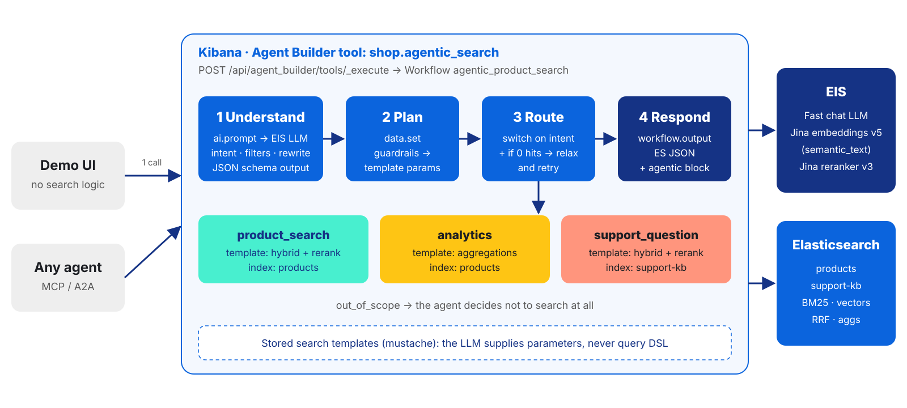
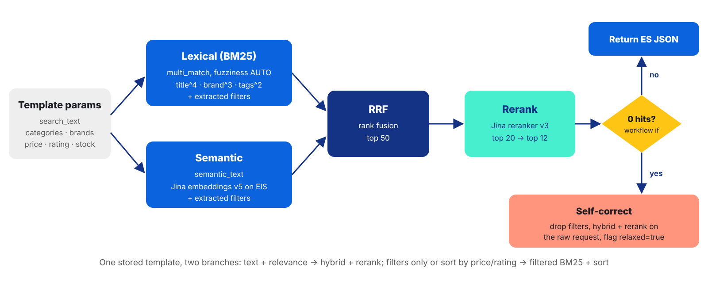
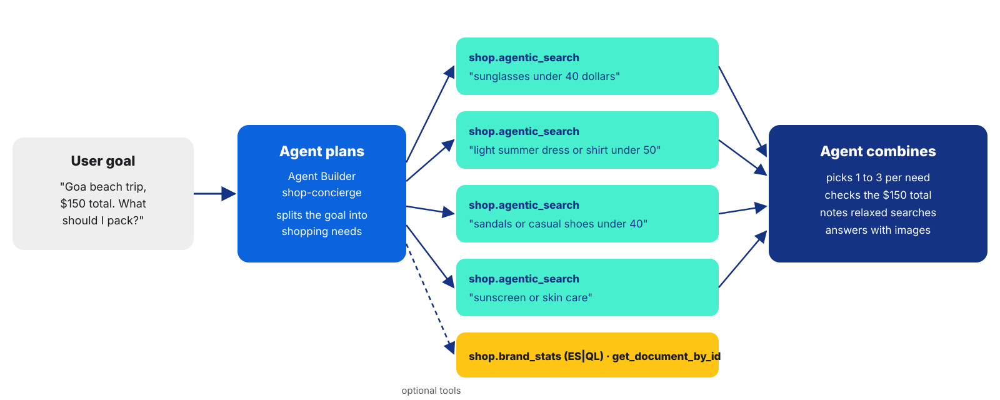

<!-- _class: cover -->

# Agentic Search:<br/>When the Agent Decides What to Search

<p class="cover-author"><strong>Ashish Tiwari</strong><br/>Principal Solutions Architect (Search AI Specialist)</p>
<p class="cover-sub">September 25, 2026</p>

<!--
0:00-0:30. Introduce yourself. One line: today we let the agent decide what to search, and keep Elasticsearch deciding what's relevant.
-->

---

<!-- _class: body-accent ppt-agenda-s4 -->

# Agenda

<div class="ppt-agenda-s4-rows">
  <div class="ppt-agenda-s4-row"><span class="ppt-agenda-s4-num">01</span><span class="ppt-agenda-s4-title">Why search breaks</span></div>
  <div class="ppt-agenda-s4-rule" aria-hidden="true"></div>
  <div class="ppt-agenda-s4-row"><span class="ppt-agenda-s4-num">02</span><span class="ppt-agenda-s4-title">The autonomy ladder</span></div>
  <div class="ppt-agenda-s4-rule" aria-hidden="true"></div>
  <div class="ppt-agenda-s4-row"><span class="ppt-agenda-s4-num">03</span><span class="ppt-agenda-s4-title">Built natively in Elastic</span></div>
  <div class="ppt-agenda-s4-rule" aria-hidden="true"></div>
  <div class="ppt-agenda-s4-row"><span class="ppt-agenda-s4-num">04</span><span class="ppt-agenda-s4-title">Live demo</span></div>
  <div class="ppt-agenda-s4-rule" aria-hidden="true"></div>
  <div class="ppt-agenda-s4-row"><span class="ppt-agenda-s4-num">05</span><span class="ppt-agenda-s4-title">What it costs, and where to start</span></div>
</div>

<!-- 0:30-1:00. Don't read it. "Problem, mental model, how it's built, show it, what it costs." -->

---

<!-- _class: body-accent lr-chrome-skip ppt-appealing-layout layout-two-cards-shadow -->

<div class="ppt-two-cards-page">
  <div class="ppt-two-cards-page__header">
    <h2>“something to keep my coffee hot on a long drive”</h2>
    <p>Same index. Same Elasticsearch. Only one thing changed: who decides what to search for.</p>
  </div>
  <div class="ppt-two-cards-page__pair">
    <div class="ppt-shadow-card ppt-shadow-card--mint">
      <h3>Agentic search</h3>
      <p>Understands the <strong>need</strong>: a travel mug or thermos. Rewrites the query, picks the category, then runs hybrid search with reranking.</p>
    </div>
    <div class="ppt-shadow-card ppt-shadow-card--muted">
      <h3>Keyword search</h3>
      <p>Matches the <strong>words</strong>: coffee beans, coffee makers, anything that says “coffee”. It did exactly what we asked.</p>
    </div>
  </div>
</div>

<!--
1:00-3:00. Hook. Optionally flip to the UI "Classic vs Agentic" tab and run this live.
Say: "Nothing is broken. The engine matched words. I asked in words, but I meant a need."
-->

---

<!-- _class: section-divider-blue-a -->

# Why search breaks

---

<!-- _class: body-accent lr-chrome-skip ppt-appealing-layout layout-split-cards-2x2-headings -->

<div class="ppt-split-cards">
  <div class="ppt-split-cards__intro">
    <h2>Users describe needs, not queries</h2>
    <p>Traditional search assumes the user knows <strong>what to ask</strong> and <strong>where to look</strong>. Four real queries from the demo catalog show where that breaks.</p>
  </div>
  <div class="ppt-split-cards__grid ppt-split-cards__grid--2x2">
    <div class="ppt-accent-card"><h3>Needs, not keywords</h3><p>“keep my coffee hot” means a thermos, not coffee.</p></div>
    <div class="ppt-accent-card"><h3>Hidden constraints</h3><p>“nike running shoes under 100 dollars” is a brand, a category and a price filter.</p></div>
    <div class="ppt-accent-card"><h3>Messy input</h3><p>“samsng phone”, “sasta laal lipstick”: typos and Hinglish.</p></div>
    <div class="ppt-accent-card"><h3>Wrong place to look</h3><p>“can I return perfume?” is a policy question, not a product search.</p></div>
  </div>
</div>

<!--
3:00-5:00. India angle: "Our users type in Hinglish, abbreviate and misspell brands. Query understanding isn't nice-to-have for us, it's table stakes."
We spent 20 years teaching users to speak search engine. Agentic search flips it.
-->

---

<!-- _class: body-accent lr-chrome-skip layout-quote-single-dark -->

# The idea in one line

> “The agent decides what to search. Elasticsearch still decides what's relevant.”

<p class="qs-by">The design principle for the rest of this talk</p>

<!-- 5:00-5:30. Pause. Let it land. -->

---

<!-- _class: section-divider-teal-a -->

# The autonomy ladder

---

<!-- _class: body-accent lr-chrome-skip layout-roadmap-pills-dark -->

# “Agentic” is a ladder, not a switch

<p class="rm-sub">Each rung hands one more decision from the user to the model. Pick the rung per use case.</p>

<div class="rm-track">
  <div class="rm-phase"><span class="rm-pill">L1 Hybrid</span><p class="rm-cap">BM25 + vectors + rerank. The engine decides relevance.</p></div>
  <div class="rm-dash" aria-hidden="true"></div>
  <div class="rm-phase"><span class="rm-pill">L2 Understand</span><p class="rm-cap">The LLM picks filters, fixes typos, rewrites.</p></div>
  <div class="rm-dash" aria-hidden="true"></div>
  <div class="rm-phase"><span class="rm-pill">L3 Route</span><p class="rm-cap">The LLM picks where to search, retries on zero hits.</p></div>
  <div class="rm-dash" aria-hidden="true"></div>
  <div class="rm-phase"><span class="rm-pill">L4 Agent</span><p class="rm-cap">The agent picks which searches and how many, then combines.</p></div>
</div>

<!--
5:30-8:00. L0 is plain keyword search: the user decides everything.
"Most teams jump straight to L4 because it demos well. In production most value sits at L2 and L3: deterministic, fast, debuggable. The L4 agent should CALL L2/L3 as a tool, not replace it."
-->

---

<!-- _class: body-accent lr-chrome-skip ppt-appealing-layout layout-split-blue-rail -->

<div class="ppt-split-blue-rail">
  <div class="ppt-split-blue-rail__aside">
    <h2>Give each job to the right component</h2>
    <p>The LLM is good at judgement and bad at retrieval. Elasticsearch is the opposite. Keep them in their lanes.</p>
  </div>
  <div class="ppt-split-blue-rail__main">
    <div class="ppt-split-blue-rail__row"><p><strong>LLM for judgement</strong>: intent, filters, rewrite, route, as structured JSON.</p></div>
    <div class="ppt-split-blue-rail__row"><p><strong>Elasticsearch for retrieval</strong>: hybrid search, RRF, reranking, aggregations.</p></div>
    <div class="ppt-split-blue-rail__row"><p><strong>Workflows for control</strong>: deterministic steps, guardrails, a trace for every run.</p></div>
    <div class="ppt-split-blue-rail__row"><p><strong>Agent Builder for reach</strong>: the same pipeline as an API, a chat agent, MCP and A2A.</p></div>
  </div>
</div>

<!-- 8:00-9:00. This is the architecture in one slide. -->

---

<!-- _class: section-divider-dev-blue-a -->

# Built natively in Elastic

---

<!-- _class: diagram-slide diagram-wide -->

# One API call, one workflow, zero glue code



<!--
9:00-11:00. Walk left to right.
"The UI makes one call. Everything else runs inside Elastic. No LangChain service, no Lambda."
Per request: one LLM call + one search (two if the zero-hit retry fires).
-->

---

<!-- _class: code-slide -->

# The LLM fills a schema. It never writes query DSL.

<div class="cols">
<div class="col">

## 1 · ai.prompt output (JSON schema)

```json
{
  "intent": "product_search",
  "search_text": "running shoes",
  "categories": ["mens-shoes", "womens-shoes"],
  "brands": ["Nike"],
  "price_max": 100,
  "sort_by": "relevance",
  "reasoning": "Nike running shoes, $100 cap"
}
```

<p class="note">Grounded: the prompt carries the <strong>real</strong> category and brand list from the index, so “samsng” becomes Samsung.</p>

</div>
<div class="col">

## 2 · stored search template (mustache)

```json
"filter": [
  { "bool": { "should": [
    {{#brands}}{ "term": { "brand": "{{.}}" } },{{/brands}}
    {{^brands}}{ "match_all": {} },{{/brands}}
    { "match_none": {} } ] } },
  {{#price_max}}
  { "range": { "price": { "lte": {{price_max}} } } },
  {{/price_max}}
  { "match_all": {} }
]
```

<p class="note">The query is written and tested by us. The model only supplies parameters, so a bad answer can't produce a bad query.</p>

</div>
</div>

<!--
11:00-13:00. The most important design choice in the talk.
"That's the difference between a demo and something that passes a bank's security review."
-->

---

<!-- _class: diagram-slide diagram-wide -->

# Hybrid retrieval, reranking, self-correction



<!--
13:00-14:30. semantic_text on EIS: no model hosting, multilingual. RRF fuses. Reranker makes the top 12 the best 12.
Self-correction is the "agentic" part here: the workflow notices zero hits and changes strategy.
-->

---

<!-- _class: body-accent lr-chrome-skip ppt-appealing-layout layout-cards-grid-2x3 -->

<div class="ppt-grid-page">
  <h2 class="ppt-grid-page__title">Six Elastic building blocks, no extra services</h2>
  <div class="ppt-card-grid--2x3">
    <div class="ppt-accent-card"><h3>semantic_text on EIS</h3><p>Jina v5 embeddings created at ingest. No model hosting.</p></div>
    <div class="ppt-accent-card"><h3>Retrievers</h3><p>rrf fuses BM25 and semantic results in one request.</p></div>
    <div class="ppt-accent-card"><h3>Reranker</h3><p>text_similarity_reranker with Jina reranker v3.</p></div>
    <div class="ppt-accent-card"><h3>Search templates</h3><p>Tested query shapes. The LLM fills parameters only.</p></div>
    <div class="ppt-accent-card"><h3>Workflows</h3><p>ai.prompt, switch, if, data.set, workflow.output in YAML.</p></div>
    <div class="ppt-accent-card"><h3>Agent Builder</h3><p>Workflow tools, ES|QL tools, agents, MCP and A2A.</p></div>
  </div>
</div>

<!-- 14:30-15:00. Quick recap before the demo. -->

---

<!-- _class: section-divider-blue-b -->

# Live demo

---

<!-- _class: body-accent lr-chrome-skip layout-timeline-horizontal-white -->

# Demo run-sheet

<p class="tl-sub">ShopSphere: 194 real products with images, 20 help-centre articles, one Elastic Serverless project.</p>

<div class="tl-wrap">
  <div class="tl-line" aria-hidden="true"></div>
  <div class="tl-nodes">
    <span class="tl-node" aria-hidden="true"></span>
    <span class="tl-node" aria-hidden="true"></span>
    <span class="tl-node" aria-hidden="true"></span>
    <span class="tl-node" aria-hidden="true"></span>
  </div>
</div>
<div class="tl-grid">
  <div class="tl-col"><h3>1 · Classic vs agentic</h3><p>“keep my coffee hot on a long drive”, “red lipstick sasta”</p></div>
  <div class="tl-col"><h3>2 · Understand</h3><p>“nike running shoes under 100 dollars”, “samsng phone”, “cheapest laptop in stock”</p></div>
  <div class="tl-col"><h3>3 · Route + self-correct</h3><p>“best rated laptop brand?”, “can I return perfume?”, “capital of France”, “gucci running shoes”</p></div>
  <div class="tl-col"><h3>4 · The agent decides</h3><p>“Goa beach trip, $150 total. What should I pack?”</p></div>
</div>

<!--
15:00-25:00. Switch to the UI (localhost:8080). ~2.5 min per column.
In tab 1, open the JSON drawer once: Response, Search-template params, Workflow execution trace.
Fallback: if the network fails, use screenshots / Kibana workflow execution history.
-->

---

<!-- _class: code-slide -->

# Still Elasticsearch JSON, plus the reason why

<div class="cols">
<div class="col">

## What the API returns

```json
{
  "took": 41,
  "hits": {
    "total": { "value": 7 },
    "hits": [
      { "_score": 0.93,
        "_source": { "title": "Nike Air Jordan 1…",
                     "brand": "Nike", "price": 89.99 } }
    ]
  },
  "agentic": {
    "route": "product_search",
    "rewritten_query": "running shoes",
    "relaxed_fallback": false,
    "execution_id": "…"
  }
}
```

</div>
<div class="col">

## Why that matters

- **Your front-end doesn't change**: same `took`, `hits`, `aggregations`
- **Explainable**: the `agentic` block says what was decided and why
- **Traceable**: every run has an execution trace in Kibana, step by step
- **Reusable**: the same tool serves the UI, the agent, and MCP / A2A clients

</div>
</div>

<!-- Show this right after demo step 2, or skip if time is short. Values shown are illustrative. -->

---

<!-- _class: diagram-slide diagram-wide -->

# L4: the agent decides what, and how often, to search



<!--
Demo step 4. "I didn't write this plan. The agent did. And every search it ran is the same guardrailed pipeline from L2/L3."
-->

---

<!-- _class: section-divider-teal-b -->

# What it costs, and where to start

---

# Trade-offs, and how we handled them

| Concern | What we did in the demo |
|---|---|
| **Latency** | One LLM call per search, a small fast model on EIS, `reasoning-level: none`, catalog list built into the prompt |
| **Wrong answers** | JSON schema output, index vocabulary in the prompt, stored templates, zero-hit fallback |
| **Debuggability** | Every run has a workflow execution trace; the response carries the decisions |
| **Cost** | Agent (L4) only for goals; single searches stay at L2/L3 |
| **Lock-in** | Standard ES JSON out; the tool is exposed over MCP and A2A |

<!--
25:00-27:00. Be honest: L4 agent responses take several seconds; L2/L3 search is one model call.
Run `python3 setup.py --timing` beforehand and quote your real numbers here.
-->

---

<!-- _class: body-accent lr-chrome-skip ppt-appealing-layout layout-three-cards-teal-border -->

<div class="tct-head">
  <h2>Start on Monday</h2>
  <p>You don't need a new stack. Put a thin agentic layer in front of the index you already have.</p>
</div>
<div class="tct-row">
  <div class="tct-card"><h3>1 · Understand</h3><p>One workflow: ai.prompt → search template on your existing index.</p></div>
  <div class="tct-card"><h3>2 · Route</h3><p>Add a switch for your second index and a zero-hit fallback.</p></div>
  <div class="tct-card"><h3>3 · Expose</h3><p>Wrap it as an Agent Builder tool. Let agents call it over MCP.</p></div>
</div>

<!-- 27:00-28:00. Call to action. Then thank you + Q&A. -->

---

<!-- _class: closing -->

# Thank you!

<p class="closing-sub">Questions? The demo project: workflows, templates, agent and UI.</p>
